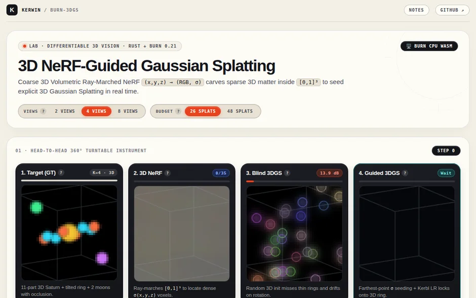

# 🪐 3D NeRF-Guided Gaussian Splatting — Burn (Rust)

[](https://github.com/magikerwin/burn-nerf-guided-splats/actions/workflows/deploy.yml)
[](https://burn.dev/)
[](https://magikerwin.github.io/burn-nerf-guided-splats/)
[](./LICENSE)

> An interactive, browser-based 3D differentiable rendering engine combining **Volumetric Ray-Marched Neural Radiance Fields (NeRF)** and **3D Gaussian Splatting (3DGS)** built with the [Burn](https://burn.dev/) deep learning framework in Rust. Watch a coarse 3D NeRF discover volumetric density `σ(x, y, z)` to guide explicit 3D Gaussian Splatting right in your browser!
>
> 🚀 **[Try the Live WebAssembly Demo!](https://magikerwin.github.io/burn-nerf-guided-splats/)**



---

## 📑 Table of Contents

- [Features](#-features)
- [Model Architecture](#️-model-architecture)
- [Project Structure](#-project-structure)
- [Getting Started](#-getting-started)
  - [Run CLI Showcase & Benchmarks](#run-cli-showcase--benchmarks)
  - [Run Tests](#run-tests)
  - [Client-Side WebAssembly App (WASM)](#client-side-webassembly-app-wasm)
- [3D Saturn Scene & Hybrid Tuning Details](#-3d-saturn-scene--hybrid-tuning-details)
- [References](#-references)
- [License](#-license)

---

## ✨ Features

- **True 3D Volumetric Ray-Marched NeRF (`VolumetricNerfModel`)** — Evaluates Fourier-encoded 3D world coordinates `(x, y, z) ∈ [0, 1]³ → (RGB, σ)` along camera rays with Mildenhall volume rendering (`T_k = exp(-Δt · ∑_{j < k} σ_j)`) accelerated via a fused strict-upper-triangular `matmul`.
- **Depth-Sorted 3D Gaussian Splatting (`GaussianModel`)** — Projects explicit 3D Gaussians (3D Means, Log-Scales, Rotation, RGB Logits, Opacity Logit) under arbitrary 360° `(yaw, pitch)` turntable cameras with exact front-to-back α-compositing (`argsort` + strict-lower-triangular transmittance `matmul`).
- **Farthest-Point 3D Voxel Seeding** — Samples active 3D NeRF density voxels (`α ≥ τ`) using density-weighted 3D farthest-point selection (`min_dist² · (0.4 + α)`) so thin 3D rings, planet cores, and distant moons all receive balanced 3D Gaussian coverage.
- **Kerbl-Style Decoupled Parameter-Group Learning Rates** — Uses Burn's `GradientsParams::from_params` to step 3D positions (`lr_means = 0.10 × base_lr`) and scales (`0.30 × base_lr`) more gently than color/opacity logits (`1.0 × base_lr`), preventing Adam from kicking newly seeded splats off 3D surfaces.
- **Instant-NGP Foreground/Sky Ray Balancing** — Balances foreground object rays against empty-sky carving rays (`1 + 6 · target_rgb`) with an `8×` unit-cube optical extinction scale so sparse 3D structures solidify within ~35 warmup steps.
- **Universal Mobile-First WebAssembly + Native WGPU** — Runs lightweight `Autodiff<Flex>` WebAssembly directly in any mobile or desktop browser (zero WebGPU driver quirks or shader stalls), plus hardware-accelerated `Autodiff<Wgpu>` via `--gpu` in the native CLI.
- **Space-Age Industrial Studio UI** — Tactile lunar-ceramic chassis (`#f4f0e6`) paired with obsidian CRT 3D viewports (`#14151a`), 3 scene presets (`Saturn`, `DNA Helix`, `Hollow Cage`), configurable camera views (`K = 2, 4, 8`) and splat budgets (`N = 14, 24, 36`), live 3D ellipse overlays, and real-time Burn telemetry.
- **Fully in Rust** — Differentiable ray marcher, depth-sorted 3D splat rasterizer, hybrid voxel bridge, CLI benchmarks, and WebAssembly bindings in a single crate.

---

## 🏗️ Model Architecture

The hybrid pipeline couples an implicit volumetric coordinate MLP (Stage 1) with an explicit differentiable 3D Gaussian rasterizer (Stage 3) through a 3D density-lattice seeding bridge (Stage 2):

```text
Stage 1 — Coarse 3D Volumetric NeRF Discovery (35–45 Warmup Steps)
  Camera Rays (u, v, yaw, pitch) × S=14 Depth Samples ──► World Points (x, y, z) [R × 14 × 3]
    → Fourier Positional Encoding (L=4 octaves, sin/cos)                        [R × 14 × 24]
    → Linear(24 → 32) → ReLU → Linear(32 → 32) → ReLU → Linear(32 → 4)          [R × 14 × 4]
    → Sigmoid(RGB), Softplus(σ - 1.3) × 8.0Δt Extinction
    → Fused Upper-Triangular Log-Transmittance Matmul ──► Rendered Coarse Views [H_c × W_c × 3]

Stage 2 — 3D Density Lattice Extraction & Farthest-Point Seeding
  15×15×15 Lattice Query in [0.12, 0.88]³ ──► 3,375 Voxels (x, y, z, r, g, b, α_voxel)
    → Active Voxel Filter: α_voxel ≥ α_min + 0.35(α_max - α_min)
    → 3D Farthest-Point Selection: argmax min_dist² · (0.4 + α_voxel) ──► N Seeded 3D Gaussians

Stage 3 — Explicit Depth-Sorted 3D Gaussian Splatting Refinement
  Trainable Params: means [N, 3], scales [N, 2], rotations [N, 1], colors [N, 3], opacities [N, 1]
    → 3D Turntable Projection R_x(pitch)·R_y(yaw) ──► 2D Centers [N, 2] & Depths d_cam [N]
    → Front-to-Back Depth Argsort + 2D Anisotropic Covariance Σ = R S Sᵀ Rᵀ
    → Fused Strict-Lower-Triangular Transmittance T_i = ∏_{j<i}(1 - α_j G_j)
    → Kerbl Decoupled Adam Step (lr_means = 0.1×, lr_scales = 0.3×, lr_appearance = 1.0×)
```

### Mathematical Formulation

1. **Volumetric Ray Marching (`VolumetricNerfModel`)**
   ```text
   C(r) = ∑_{k=1..S} T_k · (1 - exp(-σ_k · Δt)) · c_k
   T_k  = exp(-∑_{j < k} σ_j · Δt)
   ```

2. **Depth-Sorted 3D Gaussian α-Compositing (`GaussianModel`)**
   ```text
   C(p)   = ∑_{i=1..N} c_i · α_i(p) · ∏_{j < i} (1 - α_j(p))
   α_i(p) = o_i · exp(-½ (p - μ'_i)ᵀ Σ_i⁻¹ (p - μ'_i))
   ```

---

## 📁 Project Structure

```text
burn-nerf-guided-splats/
├── src/
│   ├── lib.rs              # Crate root exporting model, training, hybrid, utils, & wasm modules
│   ├── main.rs             # Flagship 3D Saturn CLI runner (Flex CPU default / --gpu Wgpu) & PNG exporter
│   ├── model/
│   │   ├── mod.rs          # ImageFitter & MultiViewFitter trait definitions
│   │   ├── gaussian.rs     # Depth-sorted 3D Gaussian Splatting & turntable projection
│   │   └── nerf.rs         # Fourier Positional Encoding, VolumetricNerfModel, & NerfModel
│   ├── hybrid.rs           # 3D active-voxel farthest-point seeding & multi-view importance bridge
│   ├── training.rs         # Kerbl-scheduled per-parameter-group Burn autodiff optimizers
│   ├── utils.rs            # Image <-> Tensor conversions & synthetic target generators
│   └── wasm.rs             # WebGPU + Flex CPU WASM session bindings & async buffer getters
├── examples/
│   ├── 01_single_splat.rs      # Minimal ~40-line Burn autodiff Gaussian Splatting intro
│   ├── 02_spectral_bias.rs     # Spectral Bias Lab: L=0 (raw coords) vs L=8 (Fourier PE)
│   └── 03_hybrid_benchmark.rs  # Fair 3D Saturn benchmark: Blind 3DGS vs Volumetric-Guided 3DGS
├── web/                    # Zero-build static WebAssembly frontend (served by GitHub Pages)
│   ├── index.html          # Space-Age Studio 4-stage 3D turntable instrument & console
│   ├── style.css           # Lunar-ceramic + Module Obsidian responsive tokens & layout
│   ├── index.js            # GpuTaskQueue mutex, live 3D ellipse overlay, & race loop
│   └── pkg/                # Compiled WASM output (gitignored, built automatically in CI)
└── assets/
    └── web_demo.webp       # Live WebAssembly showcase animation
```

---

## 🚀 Getting Started

### Run CLI Showcase & Benchmarks

By default, the CLI runs on the fast `Autodiff<Flex>` CPU backend (works out of the box everywhere) and exports `128×128` novel-view renders (`target.png`, `output_nerf.png`, `output_blind_3dgs.png`, `output_guided_3dgs.png`):

```sh
cargo run --release
```

To accelerate on your GPU (`Autodiff<Wgpu>` backend):

```sh
cargo run --release -- --gpu
```

You can also step through the three progressive educational examples:

```sh
# 1. Minimal Burn Autodiff Gaussian Splatting intro
cargo run --release --example 01_single_splat

# 2. Spectral Bias Lab: L=0 (raw coords) vs L=8 (Fourier Positional Encoding)
cargo run --release --example 02_spectral_bias

# 3. True 3D Saturn Benchmark: Blind 3DGS vs Volumetric Ray-Marched NeRF-Guided 3DGS
cargo run --release --example 03_hybrid_benchmark
```

#### 📊 Results

Evaluated across **three contrasting 3D topologies** inside `[0, 1]³` (`N = 28` 3D Gaussians, 4 training views + 4 unseen 360° novel test views):

| 3D Scene Topology | Blind 3DGS (Novel 360° PSNR) | 3D Volumetric-Guided 3DGS (Ours) | Fair 3D Gain |
| :--- | :---: | :---: | :---: |
| **Saturn Ring** *(core + tilted ring + moons)* | `20.37 dB` (`6.93 s`) | **`23.86 dB` (`6.73 s`)** | **`+3.48 dB` (faster)** |
| **3D DNA Helix** *(intertwined double spiral)* | `17.23 dB` (`6.56 s`) | **`23.19 dB` (`5.82 s`)** | **`+5.96 dB` (faster)** |
| **Hollow 3D Cage** *(empty center + outer frame)* | `18.20 dB` (`6.47 s`) | **`20.64 dB` (`5.72 s`)** | **`+2.44 dB` (faster)** |

<details>
<summary>📝 Example Terminal Output (03_hybrid_benchmark & 02_spectral_bias)</summary>

```text
cargo run --release --example 03_hybrid_benchmark
=== Multi-Topology 3D Volumetric NeRF -> 3DGS Benchmark (4 Train + 4 Novel 360° Views, N=28) ===
  [Saturn Ring   ] Blind 3DGS (6929 ms): 20.37 dB  |  3D-Guided (6725 ms): 23.86 dB  (+3.48 dB!)
  [3D DNA Helix  ] Blind 3DGS (6563 ms): 17.23 dB  |  3D-Guided (5824 ms): 23.19 dB  (+5.96 dB!)
  [Hollow 3D Cage] Blind 3DGS (6474 ms): 18.20 dB  |  3D-Guided (5719 ms): 20.64 dB  (+2.44 dB!)

cargo run --release --example 02_spectral_bias
=== Example 02: Neural Spectral Bias (120 Adam Steps on High-Frequency Checkerboard) ===
  L = 0 (Raw (x,y) only)        -> MSE: 0.02158 | PSNR: 16.66 dB (Blurry low-freq wash!)
  L = 8 (Fourier sin/cos 2^k π) -> MSE: 0.00069 | PSNR: 31.64 dB (Crisp checkerboard!)
  Fourier Positional Encoding Gain: +14.98 dB
```

</details>

---

### Run Tests

Run all 15 unit tests verifying covariance projection, front-to-back occlusion autodiff, Fourier positional encoding, volumetric 3D ray marching, stereo depth triangulation, and 3D voxel seeding:

```sh
cargo test --release
```

---

### Client-Side WebAssembly App (WASM)

Both `VolumetricNerfModel` and `GaussianModel` compile directly to lightweight WebAssembly (`~2.0 MB` `.wasm`, `~500 KB` gzipped) for 100% client-side in-browser training and real-time 360° rendering across mobile and desktop browsers.

#### 1. Build & preview the WASM bundle locally

1. **Install `wasm-pack`**:
   ```sh
   cargo install wasm-pack
   ```

2. **Build the WebAssembly package**:
   ```sh
   wasm-pack build --target web --out-dir web/pkg
   ```

3. **Serve `web/` over HTTP**:
   ```sh
   python3 -m http.server 8000 --directory web
   ```
   Navigate to **[http://localhost:8000](http://localhost:8000)**.

#### 2. Automatic Deployments (GitHub Pages)

The CI workflow ([`.github/workflows/deploy.yml`](.github/workflows/deploy.yml)) automatically compiles the Rust crate to WebAssembly via `wasm-pack` and deploys `./web` to **[https://magikerwin.github.io/burn-nerf-guided-splats/](https://magikerwin.github.io/burn-nerf-guided-splats/)** on every code push to `main`.

---

## 🪐 3D Saturn Scene & Hybrid Tuning Details

Both the CLI benchmark and the live WebAssembly playground include **three contrasting 3D topologies** inside `[0, 1]³` (`> 98%` empty air) to test distinct failure modes of unguided 3D Gaussian Splatting:

| Scene Preset | 3D Geometry in `[0, 1]³` | What It Stress-Tests |
| :--- | :--- | :--- |
| **`Saturn`** | Golden core `(0.5, 0.5, 0.5)` + 8 tilted ring nodes + 2 moons | Multi-scale coverage & front/back ring occlusion |
| **`DNA Helix`** | Two intertwined 7-node 3D spirals (`R = 0.23`, phase `π`) | Continuous 360° depth-crossing where 2D silhouettes overlap (`+5.96 dB` win) |
| **`Hollow Cage`** | 8 cube corners `{0.27, 0.73}³` + 6 outer face nodes | 100% hollow center where random Blind splats get trapped inside the shell |

### Key Tuning Insights

1. **Why Uniform Adam LR Hurts Guided 3DGS**: Because Adam normalizes first-step updates to `±lr`, applying a large appearance LR (`0.05+`) to `means` violently kicks seeded Gaussians off 3D surfaces on Step 1. Scaling `lr_means = 0.10 × lr_appearance` (mirroring Kerbl et al. 2023) preserves the 3D NeRF initialization while colors and opacities converge rapidly.
2. **Why Empty-Sky Rays Must Be Balanced**: Because `> 98%` of `[0, 1]³` is empty air, unweighted pixel MSE lets empty background rays drown out thin 3D features during short warmups. Foreground ray weighting (`1 + 6 · target_rgb`) + `8×` unit-cube extinction carves crisp 3D density peaks in 35–45 steps.
3. **Why Multi-View Camera Count `K` Matters**: Switching the live demo from `4 Views` to `2 Views` demonstrates **epipolar ambiguity**—two cameras cannot uniquely triangulate concave 3D rings or helices without ghost intersections, whereas `4` or `8` views lock onto true 3D `(x, y, z)` coordinates across unseen 360° angles.

---

## 📚 References

- [Burn — Deep Learning Framework for Rust](https://burn.dev/)
- [The Burn Book](https://burn.dev/book/)
- [Mildenhall et al., "NeRF: Representing Scenes as Neural Radiance Fields for View Synthesis" (ECCV 2020)](https://arxiv.org/abs/2003.08934)
- [Kerbl et al., "3D Gaussian Splatting for Real-Time Radiance Field Rendering" (SIGGRAPH 2023)](https://repo-sam.inria.fr/fungraph/3d-gaussian-splatting/)
- [Müller et al., "Instant Neural Graphics Primitives with a Multiresolution Hash Encoding" (SIGGRAPH 2022)](https://nvlabs.github.io/instant-ngp/)
- [Tancik et al., "Fourier Features Let Networks Learn High Frequency Functions in Low Dimensional Domains" (NeurIPS 2020)](https://arxiv.org/abs/2006.10739)
- [wasm-pack — Rust WebAssembly Packager](https://rustwasm.github.io/wasm-pack/)

---

## 📄 License

This project is licensed under the [MIT License](./LICENSE).
